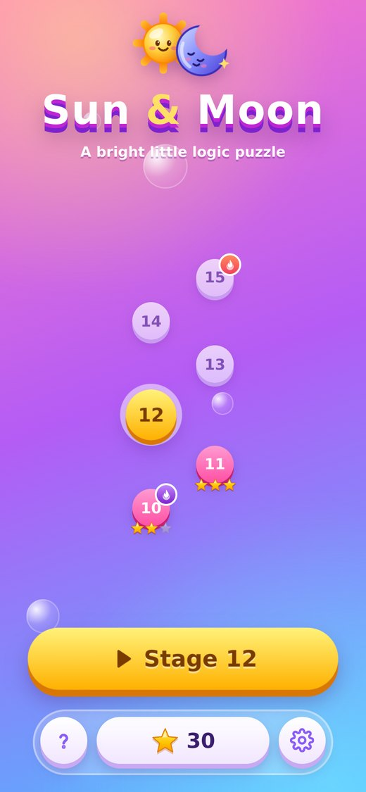
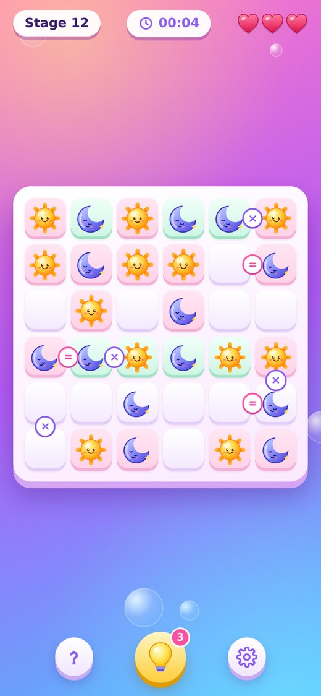
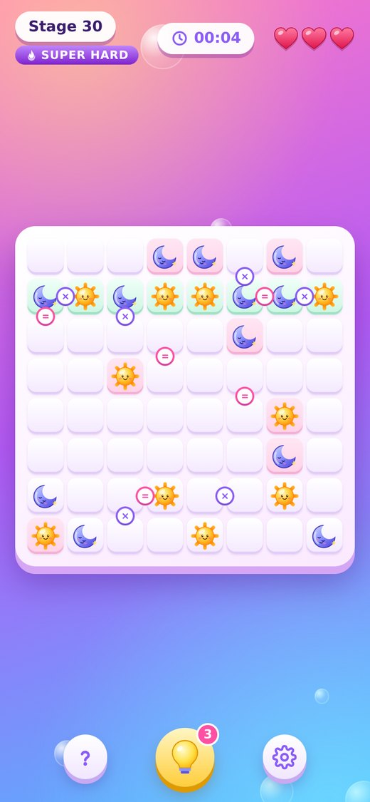
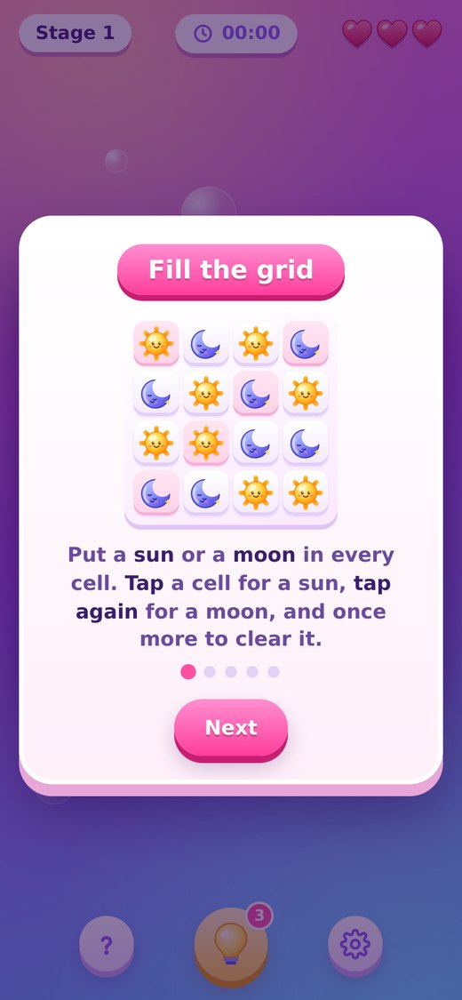
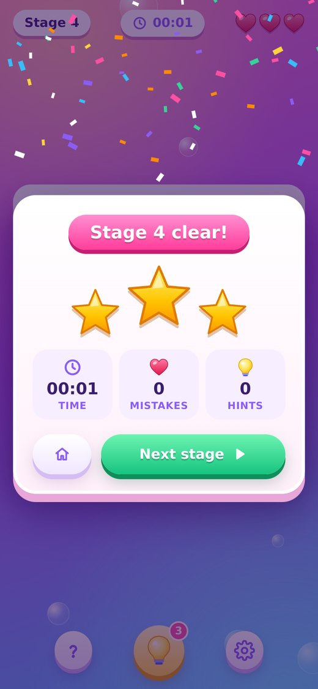
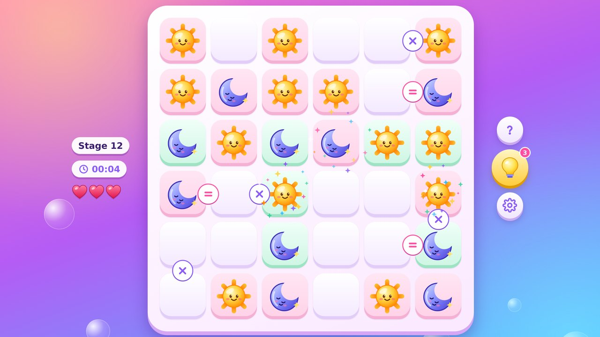

# ☀️ Sun & Moon 🌙

**A bright, relaxing logic puzzle.** Fill the grid with suns and moons, follow three simple rules, and climb through endless stages.

No guessing is ever needed: every puzzle has exactly one solution, and you can always find it with logic.

### 🎮 [Play now → robinkumar5986.github.io/Sun-Moon](https://robinkumar5986.github.io/Sun-Moon/)

It runs right in your browser on phone, tablet or desktop, with nothing to install.

## Screenshots

<table>
  <tr>
    <td align="center"><br><sub>Home &amp; stage path</sub></td>
    <td align="center"><br><sub>Solving a stage</sub></td>
    <td align="center"><br><sub>Super hard 8×8</sub></td>
  </tr>
  <tr>
    <td align="center"><br><sub>Quick tutorial</sub></td>
    <td align="center"><br><sub>Stage clear!</sub></td>
    <td></td>
  </tr>
</table>

<p align="center"><br><sub>Also plays great on desktop</sub></p>

Green tiles are lines you've already solved (they lock in place). Pink tiles are the starting clues.

## How to play

1. **Fill every cell** with a ☀️ sun or a 🌙 moon. **Tap** a cell for a sun, **tap again** for a moon, and once more to clear it.
2. **No three in a row.** You can't have more than 2 of the same symbol next to each other, across or down.
3. **Half and half.** Every row and every column has the same number of suns and moons.
4. **Clues:** `=` means two cells are the same, and `×` means they are opposite.

Each time you fill a whole row or column, it gets checked. Correct lines turn green and lock in place; a wrong line costs a life. You get **3 lives** and **3 hints** per stage. Stuck? The 💡 hint fills a cell and tells you *why*.

## Features

- 🎯 **Endless stages**, freshly generated for you and always solvable
- 📈 **Gentle difficulty curve** with exciting *Hard* and *Super hard* stages along the way
- ⭐ **Earn up to 3 stars** per stage by solving with no mistakes and no hints
- ⏱️ **Timer** to beat your own speed
- 💾 **Auto-save**: leave anytime and continue right where you stopped
- 🎵 **Soothing, ever-changing music** and playful sound effects
- 📱 **Works everywhere**: phone, tablet or desktop, portrait or landscape, with touch, mouse or keyboard

### Keyboard controls

| Key | Action |
|---|---|
| Arrow keys | Move the cursor |
| `1` / `S` | Place a sun |
| `2` / `M` | Place a moon |
| `0` / Backspace | Clear the cell |
| Space / Enter | Same as tapping |
| `H` | Hint |
| Esc | Close a dialog |

## Play online

**https://robinkumar5986.github.io/Sun-Moon/**

## Run locally

The game is plain HTML, CSS and JavaScript, with no install needed.

```sh
# from this folder
python3 -m http.server 8080
# then open http://localhost:8080
```

(Opening `index.html` directly from disk won't work, because browsers block JavaScript modules on `file://`.)

### Tests

```sh
npm test                 # puzzle engine: every stage solvable with exactly one solution
npm install              # once, for the scenario tests
npm run test:scenarios   # 21 game-flow scenarios (win, lose, saves, pause, ads, hints…)
```

## Reporting a problem

Found a bug? Open **Settings** (⚙️) in the game and note the **version number** shown at the bottom (e.g. `Version 1.6.0`). Then report the issue with that version, what you did, and what happened, along with your device and browser if possible.

## Credits

- Game design, code, art (SVG) and music (generated live with the Web Audio API): **Rk**
- No third-party assets are used.

## License

© 2026 Rk. All rights reserved. This source is shared for viewing only. Please don't copy, redistribute or republish the game or its assets.
